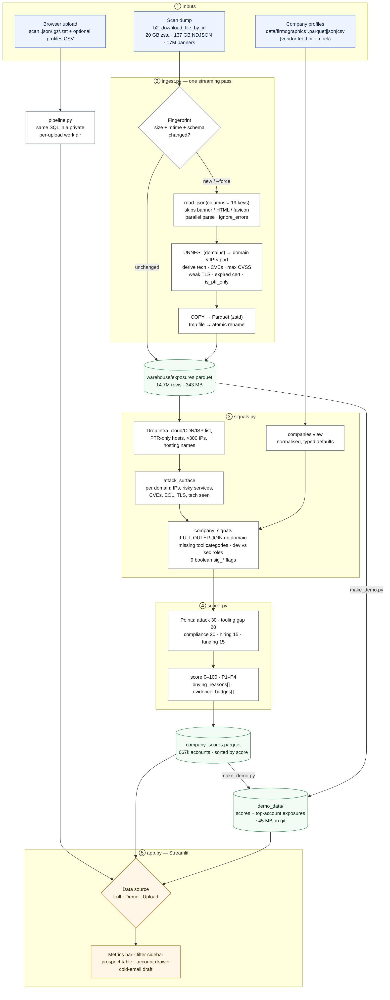
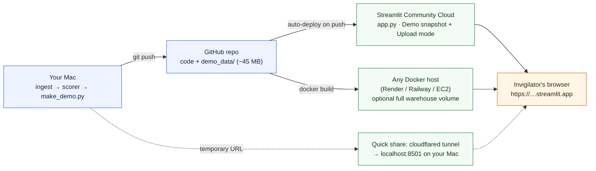

# Cybersecurity Readiness — Sales Intelligence Platform

Ranks companies by how likely they are to need a cybersecurity product *right now*,
with a deterministic 0–100 score and a plain-English `buying_reasons` array for every account.



*Diagram source: [`docs/architecture.mmd`](docs/architecture.mmd) (Mermaid). Re-render with
`npx @mermaid-js/mermaid-cli -i docs/architecture.mmd -o docs/architecture.png -s 2`.*

**Three ways data reaches the dashboard**

| Data source | Produced by | Used for |
|---|---|---|
| Full dataset | `ingest.py` → `scorer.py` on the 20 GB dump (`warehouse/`) | local analysis, full detail |
| Demo snapshot | `make_demo.py` (`demo_data/`, ~45 MB, committed to git) | hosted app |
| Upload a scan file | `pipeline.py`, triggered from the browser | analysing any new scan file |

## 1. What the data actually is

The supplied file is **not** a company-profile dataset. It is a Shodan-style internet scan:
one JSON object per `IP:port` with banners, `org`/`isp`, `domains`, `hostnames`, HTTP tech
fingerprints (`http.components`), TLS details, `tags` (`eol-product`, `self-signed`, …) and a
`vulns` map of CVE → CVSS. It has no headcount, hiring or funding fields.

The platform is therefore **hybrid**:

| Source | Signals it powers | Status |
|---|---|---|
| Scan dump (real) | attack surface, edge security vendors seen, part of tech stack, domain-inferred industry | live |
| Firmographics feed | industry, employee_count, tech_stack, hiring_signals, is_regulated, days_since_funding | **synthetic** (`firmographics.py --mock`) until you drop a vendor export in `data/` |

The dashboard shows a warning banner while the firmographic half is synthetic.

## 2. Files

| File | Purpose |
|---|---|
| `config.py` | Paths, DuckDB limits (env-overridable), scoring weights, keyword/port dictionaries |
| `ingest.py` | Streams the zstd NDJSON → `exposures.parquet`; registers `raw_scan`, `exposures`, `raw_companies`, `companies` views; idempotent via manifest |
| `firmographics.py` | `--mock` generates deterministic synthetic profiles for every prospect domain; `--check` reports match rate of a real feed |
| `signals.py` | Builds `attack_surface` and `company_signals` (boolean `sig_*` columns) |
| `scorer.py` | Computes component points, `score`, `priority`, `buying_reasons`, `evidence_badges`; exports sorted Parquet |
| `app.py` | Streamlit dashboard: data-source picker (Full / Demo / Upload), metrics bar, filter sidebar, prospect table, account drawer, cold-email draft |
| `pipeline.py` | Runs ingest → firmographics → signals → score on any file inside a private work dir (powers browser uploads; also a CLI) |
| `make_demo.py` | Writes the git-friendly `demo_data/` snapshot used by the hosted app |
| `Dockerfile`, `.streamlit/config.toml` | Container deployment and Streamlit server settings (upload limit) |
| `docs/` | Architecture and hosting diagrams (Mermaid source + PNG) |

## 3. Signal methodology

Weights live in `config.WEIGHTS` (must sum to 100). The brief's four firmographic signals keep
their relative order but share 70 points; 30 points come from the real scan evidence.

| Component | Max | Fires when | Points |
|---|---|---|---|
| **Attack surface** | 30 | Critical CVE (CVSS ≥ 9) → 12, else High CVE (≥ 7) → 6; risky service exposed (RDP, SMB, Telnet, FTP, SNMP, DBs, Redis, Elasticsearch, Docker/K8s APIs…) → 10; EOL software → 4; TLS ≤ 1.1 / expired / self-signed → 4 | sum, capped at 30 |
| **Security tooling gap** | 20 | `employee_count > 50` (or ≥ 3 eng openings) **and** at least one of EDR / IAM / SIEM-Observability / Network-Edge is missing from vendor stack ∪ scan-observed tech (CrowdStrike, Okta, Splunk, Datadog, Palo Alto, Zscaler, Imperva, Cloudflare…) | 20 × missing ÷ 4 |
| **High-risk industry / compliance** | 20 | Industry in Fintech, Banking, Payments, Insurance, Health*, Legal, SaaS, Government | 20; other `is_regulated` → 12 |
| **Hiring mismatch** | 15 | ≥ 1 dev/IT opening and 0 CISO/security openings | 15 |
| **Funding momentum** | 15 | `days_since_funding ≤ 180` | 15 |

Tiers: **P1** > 75, P2 ≥ 50, P3 ≥ 25, P4 otherwise.

Each fired signal emits one `buying_reasons` string, e.g.

```
Critical vulnerability exposure: CVE-2026-109619, CVE-2024-3566 (max CVSS 9.8) on 5 internet-facing service(s)
Admin/data services exposed to the internet: SNMP
Missing key EDR/IAM/SIEM/Observability tools with 1555 employees
High dev hiring without CISO: 2 eng/IT opening(s), 0 security openings
```

### Entity resolution (scan → company)
* Company key = registered domain from the banner's `domains` array (one banner can map to several).
* Dropped as non-prospects: a stop-list of cloud/CDN/ISP domains (`config.INFRA_DOMAINS`);
  domain×IP pairs whose hostnames are all reverse-DNS patterns (`ec2-1-2-3-4…`, `1-2-3-4.isp…`)
  — flagged as `is_ptr_only` at ingest; domains on > 300 IPs; and domains with ≥ 25 IPs whose
  name looks like hosting/ISP/dyn-DNS (`config.INFRA_DOMAIN_REGEX`).
* Some regional hosters/ISPs still slip through; extend the two config lists as you spot them.

## 4. Benchmarks (measured on the reference dump)

Machine: Linux VM, 4 vCPU, 4 GB RAM. DuckDB 1.5.6, Python 3.10.

| Step | Input | Wall time | Peak RSS | Output |
|---|---|---|---|---|
| Baseline: `zstd -dc \| wc -l` | 19.9 GB zstd | 104 s | — | 16,988,823 lines / 137.1 GB |
| `ingest.py` (`memory_limit=2GB`) | 19.9 GB zstd | **74.5 s** (≈ 1.8 GB/s of JSON) | **1.5 GB** | 14,673,218 rows, 343 MB Parquet (400× smaller) |
| `firmographics.py --mock` | 343 MB Parquet | 1.3 s | 0.5 GB | 666,678 profiles |
| `scorer.py --rebuild-signals` (2 GB) | 343 MB Parquet | 11.0 s | 2.3 GB | 666,678 scored accounts |
| `scorer.py --rebuild-signals` (1 GB) | 343 MB Parquet | 14.3 s | 1.4 GB | same |
| Same pipeline with `warehouse/` on a VM-mounted host folder | — | ingest 84 s, signals 63 s | — | keep `CI_WAREHOUSE_DIR` on local SSD |
| Dashboard drawer lookup (one domain) | 343 MB Parquet | < 0.1 s | — | — |

Why it is fast and flat on memory:
* `read_json(..., columns={...})` projects 19 keys; the 10 KB+ banner/HTML/favicon fields are never materialised.
* `preserve_insertion_order=false` lets the streaming `COPY … TO parquet` flush row groups immediately.
* Everything downstream reads the slim Parquet (projection pushdown), never the raw JSON again.
* `mode()` was replaced by `arg_max(…, seen_at)`: `mode` keeps per-group hash maps outside DuckDB's
  buffer manager and added ~1 GB RSS beyond `memory_limit`.

Result on the reference data (synthetic firmographics): 666,678 accounts, **883 P1 leads**, average score 31.2.

## 5. Running it

```bash
cd IntelligencyPlaform
python3 -m venv .venv && source .venv/bin/activate
pip install -r requirements.txt

# 1) scan -> parquet (skips automatically if source + schema unchanged; --force to rebuild)
python ingest.py                         # default source: ../b2_download_file_by_id
# 2) firmographics: real feed -> data/firmographics_<vendor>.parquet|json, or synthetic:
python firmographics.py --mock
python firmographics.py --check          # match rate vs scan footprint
# 3) signals + score
python scorer.py --rebuild-signals --top 25
# 4) dashboard
streamlit run app.py
```

The `warehouse/` folder already holds the outputs of a full run, so `streamlit run app.py` works
straight away. `ingest.py` will re-run once on a new machine (the manifest stores absolute paths).

Environment overrides: `CI_MEMORY_LIMIT` (default `8GB`), `CI_THREADS`, `CI_SCAN_GLOB`,
`CI_SCAN_COMPRESSION` (`zstd`; use `auto` for `.json`/`.json.gz`), `CI_FIRMO_GLOB`,
`CI_WAREHOUSE_DIR`, `CI_DATA_DIR`, `CI_MAX_IPS_PER_COMPANY`.

`data/sample/` holds 5k- and 200k-banner slices of the dump for quick tests:
`CI_SCAN_GLOB='data/sample/scan_200k.json.zst' CI_WAREHOUSE_DIR=/tmp/wh python ingest.py`.

### Plugging in a real firmographics feed
Any JSON/Parquet with `company_id` = registered domain (e.g. `acme.com`). Missing columns get
typed defaults; extra columns are ignored. Remove/rename `data/firmographics_mock.parquet`, add
the feed, then `python scorer.py --rebuild-signals`.

## 6. Uploading a file from the browser

Pick **Upload a scan file** in the sidebar.

1. Upload newline-delimited JSON in the scan-banner format (plain, `.gz` or `.zst`; the
   compression is detected from the extension or the file's magic bytes). A 5k-line sample can be
   downloaded from the same page.
2. Optionally upload a company-profiles file (CSV / JSON / Parquet keyed by `company_id` = domain;
   in CSV, list columns such as `tech_stack` are `;`-separated). Without it, synthetic profiles are
   generated so every signal still fires.
3. Click **Run analysis**. `pipeline.run_pipeline()` saves the upload to
   `warehouse/uploads/<random-id>/`, runs the *same* SQL as the CLI scripts against an in-memory
   DuckDB (spilling to that folder), writes `exposures.parquet` + `company_scores.parquet` there and
   deletes the raw upload. Progress is shown live; the dashboard then switches to the new results.
4. Work dirs older than 24 h are cleaned up automatically. Each browser session gets its own
   folder, so visitors never see each other's data.

Upload size is capped by `server.maxUploadSize` in `.streamlit/config.toml` (500 MB). Streamlit
buffers uploads in memory, so multi-GB dumps should go through the CLI (`python ingest.py`).
The 5k sample runs end to end in under 1 s; the 200k-banner slice (353 MB) in about 2 s.

## 7. Hosting and sharing a URL



### Option A — Streamlit Community Cloud (free, permanent URL)
1. Build the demo snapshot and push it:
   ```bash
   python make_demo.py              # writes demo_data/ (~45 MB)
   git add . && git commit -m "Add upload mode, demo snapshot, diagrams" && git push
   ```
2. Go to <https://share.streamlit.io>, sign in with GitHub, **Create app** → pick
   `IntelligencyPlaform`, branch `main`, main file `app.py`, Python 3.11 → **Deploy**.
3. You get `https://<name>.streamlit.app`. In the app's **Settings → Sharing** you can restrict
   viewers to specific email addresses (recommended — see *Responsible use*), then send the link.

The hosted app shows **Demo snapshot** and **Upload a scan file**; the 20 GB dump never leaves your
machine. Free-tier containers have limited RAM (about 1 GB at the time of writing), so
`config.MEMORY_LIMIT` auto-sizes to 60% of available memory and uploads should stay small.

### Option B — Docker on any host (Render, Railway, Fly.io, EC2, Cloud Run)
```bash
docker build -t intel-platform .
docker run -p 8501:8501 intel-platform                                   # demo + upload
docker run -p 8501:8501 -v "$PWD/warehouse:/app/warehouse" intel-platform  # + full dataset
```
Use this when you need more RAM, larger uploads, or the full dataset online.

### Option C — Instant temporary link from your Mac
```bash
streamlit run app.py                      # terminal 1
brew install cloudflared                  # once
cloudflared tunnel --url http://localhost:8501   # terminal 2 → prints https://<random>.trycloudflare.com
```
The link works only while your Mac and both commands are running.

## 8. Responsible use
Scan data shows what is publicly visible, not confirmed vulnerabilities (CVE matches are
version-based). The cold-email template deliberately describes risk *categories* and never
includes IPs or CVE IDs; keep it that way, and route any genuinely critical finding through
responsible-disclosure channels rather than a sales sequence. When hosting, restrict viewers: the dashboard lists named
organisations alongside their observed exposures.
